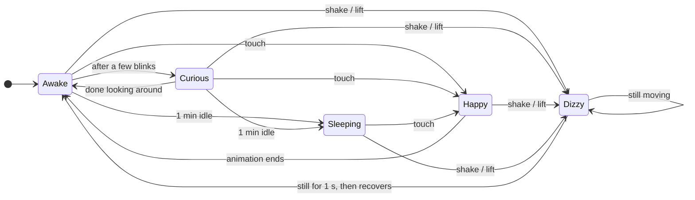
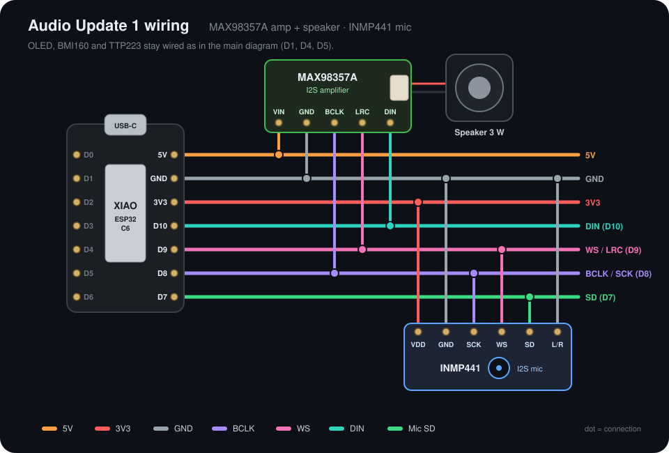

<div align="center">


# K-VRC Desk Buddy

**A tiny desk robot with animated OLED eyes that blinks, looks around, smiles when you touch it, gets dizzy when you pick it up and falls asleep when you leave it alone.**


</div>

---

## Moods

Every animation is drawn in code in real time (no bitmaps), so the eyes stay smooth at any size. These previews are rendered from the actual sketch.

<table align="center">
  <tr>
    <td align="center"><br><b>Awake</b><br><sub>Blinks every few seconds</sub></td>
    <td align="center"><br><b>Curious</b><br><sub>Looks around the room</sub></td>
    <td align="center"><br><b>Happy</b><br><sub>Touch the sensor</sub></td>
  </tr>
  <tr>
    <td align="center"><br><b>Dizzy</b><br><sub>Shake or lift it</sub></td>
    <td align="center"><br><b>Sleeping</b><br><sub>1 minute with no touch or motion</sub></td>
  </tr>
</table>

## How it behaves



- **Non-blocking:** no `delay()` in the loop. Everything runs on `millis()` and a small animation queue, so touch and motion react instantly.
- **Motion aware:** the BMI160 is read every 10 ms. Lifting the board triggers *Dizzy*; any gentle movement keeps it awake.

## Parts

| Part | Notes |
|---|---|
| Seeed Studio **XIAO ESP32-C6** | Main board |
| **0.96" OLED 128x64**, I2C (SSD1306) | 1.3" SH1106 also supported |
| **BMI160** module | 6-axis IMU, only the accelerometer is used |
| **TTP223** capacitive touch module | Pet the robot |
| 3D printed body | Head, visor and ear pieces |
| Jumper wires | |

## Wiring

<p align="center"></p>

| Module | Pin | XIAO |
|---|---|---|
| OLED | VCC / GND | 3V3 / GND |
| OLED | SDA / SCL | D4 / D5 |
| BMI160 | VCC / GND | 3V3 / GND |
| BMI160 | SDA / SCL | D4 / D5 |
| BMI160 | CS / SDO | 3V3 / GND (I2C address 0x68) |
| TTP223 | VCC / GND | 3V3 / GND |
| TTP223 | OUT | D1 |

> **Tip:** OLED modules don't all use the same pin order (some are `GND VCC SCL SDA`, others `VCC GND SCL SDA`). Always check the labels printed on your board.

## Getting started

1. Install the **Arduino IDE**.
2. Add the **esp32** board package by Espressif (Boards Manager) and select **XIAO_ESP32C6**.
3. Install the **U8g2** library by olikraus (Library Manager).
4. Open [`desk_robot/desk_robot.ino`](desk_robot/desk_robot.ino) and upload.
   With the speaker and mic installed, open [`audio_update_1/audio_update_1.ino`](audio_update_1/audio_update_1.ino) instead (see [Audio Update 1](#audio-update-1)).

Using the 1.3" SH1106 display? Uncomment `#define OLED_SH1106` at the top of the sketch.

## Tuning

All settings are constants at the top of the sketch.

| Constant | Default | What it does |
|---|---|---|
| `SHAKE_G` | `0.22` | Lower = gets dizzy more easily |
| `SHAKE_JOLTS` | `2` | Jolts needed to count as a shake |
| `DIZZY_HOLD_MS` | `1000` | How long it stays dizzy after motion stops (ms) |
| `MOTION_G` | `0.12` | Gentle-motion threshold that counts as activity |
| `IDLE_SLEEP_MS` | `60000` | Idle time before falling asleep (ms) |

## Audio Update 1

K-VRC can now **talk back and hear you**. A small I2S amplifier and speaker give it robot beeps, and a digital microphone lets it react to the room. All sounds are synthesized in code, so there's no SD card and there are no audio files.

The original silent version stays in [`desk_robot/`](desk_robot/desk_robot.ino). The audio version is in [`audio_update_1/`](audio_update_1/audio_update_1.ino).

### What's new

| Event | Sound | Face |
|---|---|---|
| Power on | Rising "hello" chirps | Awake |
| Touch | Happy arpeggio | Happy |
| Shake / lift | Wobbly "wooo-ooh", repeated while it keeps moving | Dizzy |
| Falling asleep | Slow descending tone | Eyes close |
| Sleeping | A soft snore now and then | Sleeping |
| Loud noise (clap, knock) | Surprised beep | Blinks and looks up; **wakes up if asleep** |
| Someone talks nearby | Curious "hm?" | **Listening**: looks up at you until you stop talking |

The mic measures the room's background noise and only reacts to sounds that stand out, so a fan or an air conditioner won't keep it busy. It also ignores itself while it's beeping.

### Extra parts

| Part | Notes |
|---|---|
| **MAX98357A** I2S amplifier | Class D, mono, 3 W |
| **Speaker** 4-8 &Omega;, ~3 W | Plugs into the amp's 2-pin connector or screw terminal |
| **INMP441** I2S microphone | Digital mic, 24-bit |

### Audio wiring

<p align="center"></p>

| Module | Pin | XIAO |
|---|---|---|
| MAX98357A | VIN / GND | 5V / GND |
| MAX98357A | BCLK / LRC / DIN | D8 / D9 / D10 |
| INMP441 | VDD / GND | 3V3 / GND |
| INMP441 | SCK / WS / SD | D8 / D9 / D7 |
| INMP441 | L/R | GND |

> The ESP32-C6 has a single I2S port, so the amp and the mic **share BCLK (D8) and WS (D9)** and run in full duplex.
> The XIAO's **5V** pin only has power over USB. On battery, feed the amp from 3V3 instead (a bit quieter).
> Never connect the INMP441 to 5V.

### Audio settings

| Constant | Default | What it does |
|---|---|---|
| `AUDIO_ENABLED` | `true` | `false` = silent robot (the mic still works) |
| `MIC_ENABLED` | `true` | `false` = ignore the microphone |
| `VOLUME` | `0.5` | Master volume, `0.0` - `1.0` |
| `SNORE_CHANCE` | `35` | % chance of a snore on each sleeping breath |
| `MIC_LOUD_DB` | `20` | How much louder than the room a noise must be to startle it |
| `MIC_VOICE_DB` | `10` | How much louder than the room a voice must be to make it listen |
| `MIC_VOICE_MS` | `250` | How long you must talk before it starts listening (ms) |

Requires the **esp32 board package 3.x** (ESP-IDF 5 I2S driver).

## Troubleshooting

| Problem | Fix |
|---|---|
| Screen stays black | Check VCC/GND order on the OLED and that SDA/SCL go to D4/D5 |
| Garbage or flicker on screen | Long wires: lower `u8g2.setBusClock(800000)` to `400000` |
| Gets dizzy too easily | Raise `SHAKE_G` to `0.25`-`0.30` |
| Doesn't get dizzy when lifted | Lower `SHAKE_G` to `0.18`-`0.20` |
| No sound (Audio Update 1) | Check BCLK/LRC/DIN on D8/D9/D10 and that the amp has 5V (USB connected) |
| Too loud / too quiet | Change `VOLUME` |
| Reacts to every little noise | Raise `MIC_LOUD_DB` / `MIC_VOICE_DB` |
| Never reacts to sound | Check SD on D7 and L/R on GND, then lower `MIC_LOUD_DB` / `MIC_VOICE_DB` |

## Project structure

```
.
├── desk_robot/
│   └── desk_robot.ino           # original firmware (no audio)
├── audio_update_1/
│   └── audio_update_1.ino       # firmware with speaker + microphone
├── images/                      # photos, mood GIFs and wiring diagrams
├── LICENSE
└── README.md
```

---

<div align="center">

Inspired by **K-VRC** from *Love, Death & Robots*.<br>
<sub>Fan project, not affiliated with Netflix or the show's creators.</sub>

</div>
