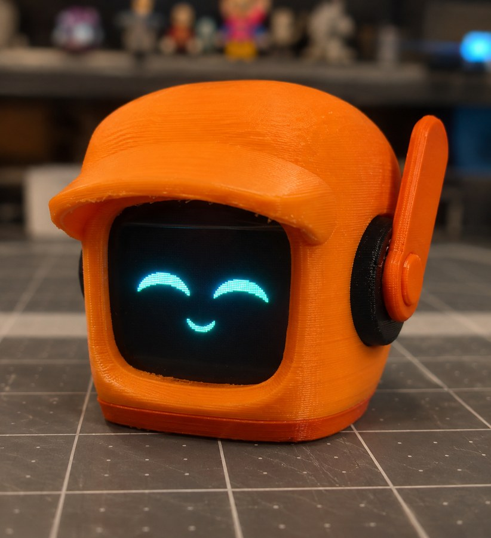
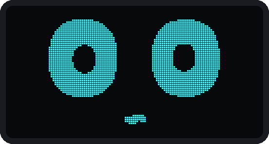
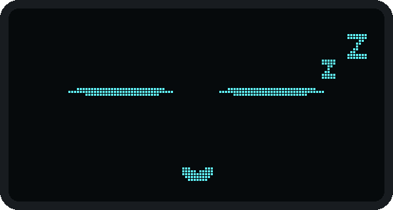
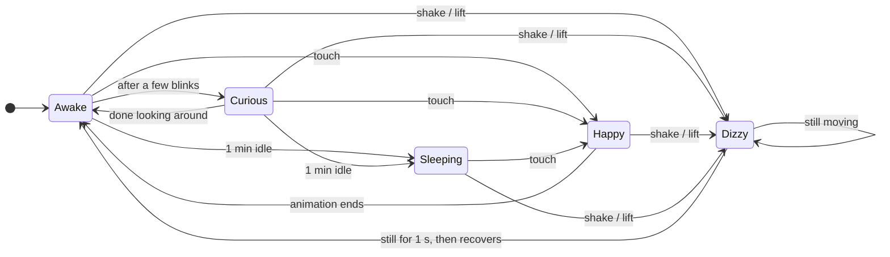
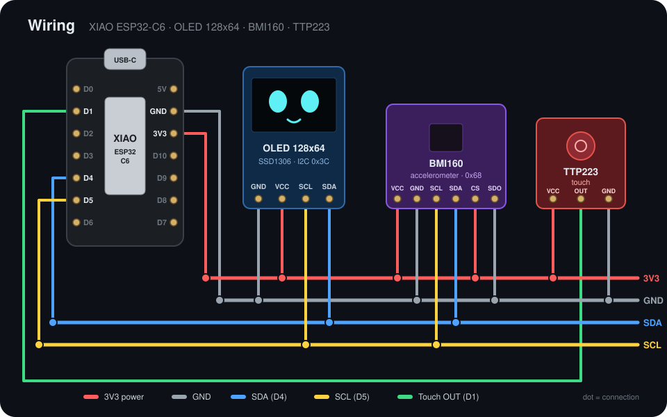

<div align="center">



# K-VRC Desk Buddy

**A tiny desk robot with animated OLED eyes that blinks, looks around, smiles when you touch it, gets dizzy when you pick it up and falls asleep when you leave it alone.**


</div>

---

## Moods

Every animation is drawn in code in real time (no bitmaps), so the eyes stay smooth at any size. These previews are rendered from the actual sketch.

<table align="center">
  <tr>
    <td align="center"><br><b>Awake</b><br><sub>Blinks every few seconds</sub></td>
    <td align="center"><br><b>Curious</b><br><sub>Looks around the room</sub></td>
    <td align="center"><br><b>Happy</b><br><sub>Touch the sensor</sub></td>
  </tr>
  <tr>
    <td align="center"><br><b>Dizzy</b><br><sub>Shake or lift it</sub></td>
    <td align="center"><br><b>Sleeping</b><br><sub>1 minute with no touch or motion</sub></td>
    <td align="center"><br><b>Always smiling</b><br><sub>The mouth stays on screen in every mood</sub></td>
  </tr>
</table>

## How it behaves



- **Non-blocking:** no `delay()` in the loop. Everything runs on `millis()` and a small animation queue, so touch and motion react instantly.
- **Motion aware:** the BMI160 is read every 10 ms. Lifting the board triggers *Dizzy*; any gentle movement keeps it awake.

## Parts

| Part | Notes |
|---|---|
| Seeed Studio **XIAO ESP32-C6** | Main board |
| **0.96" OLED 128x64**, I2C (SSD1306) | 1.3" SH1106 also supported |
| **BMI160** module | 6-axis IMU, only the accelerometer is used |
| **TTP223** capacitive touch module | Pet the robot |
| 3D printed body | Head, visor and ear pieces |
| Jumper wires | |

## Wiring

<p align="center"></p>

| Module | Pin | XIAO |
|---|---|---|
| OLED | VCC / GND | 3V3 / GND |
| OLED | SDA / SCL | D4 / D5 |
| BMI160 | VCC / GND | 3V3 / GND |
| BMI160 | SDA / SCL | D4 / D5 |
| BMI160 | CS / SDO | 3V3 / GND (I2C address 0x68) |
| TTP223 | VCC / GND | 3V3 / GND |
| TTP223 | OUT | D1 |

> **Tip:** OLED modules don't all use the same pin order (some are `GND VCC SCL SDA`, others `VCC GND SCL SDA`). Always check the labels printed on your board.

## Getting started

1. Install the **Arduino IDE**.
2. Add the **esp32** board package by Espressif (Boards Manager) and select **XIAO_ESP32C6**.
3. Install the **U8g2** library by olikraus (Library Manager).
4. Open [`desk_robot/desk_robot.ino`](desk_robot/desk_robot.ino) and upload.

Using the 1.3" SH1106 display? Uncomment `#define OLED_SH1106` at the top of the sketch.

## Tuning

All settings are constants at the top of the sketch.

| Constant | Default | What it does |
|---|---|---|
| `SHAKE_G` | `0.22` | Lower = gets dizzy more easily |
| `SHAKE_JOLTS` | `2` | Jolts needed to count as a shake |
| `DIZZY_HOLD_MS` | `1000` | How long it stays dizzy after motion stops (ms) |
| `MOTION_G` | `0.12` | Gentle-motion threshold that counts as activity |
| `IDLE_SLEEP_MS` | `60000` | Idle time before falling asleep (ms) |

## Troubleshooting

| Problem | Fix |
|---|---|
| Screen stays black | Check VCC/GND order on the OLED and that SDA/SCL go to D4/D5 |
| Garbage or flicker on screen | Long wires: lower `u8g2.setBusClock(800000)` to `400000` |
| Gets dizzy too easily | Raise `SHAKE_G` to `0.25`-`0.30` |
| Doesn't get dizzy when lifted | Lower `SHAKE_G` to `0.18`-`0.20` |

## Project structure

```
.
├── desk_robot/
│   └── desk_robot.ino   # the whole firmware
├── images/              # photos, mood GIFs and wiring diagram
├── LICENSE
└── README.md
```

---

<div align="center">

Inspired by **K-VRC** from *Love, Death & Robots*.<br>
<sub>Fan project, not affiliated with Netflix or the show's creators.</sub>

</div>
